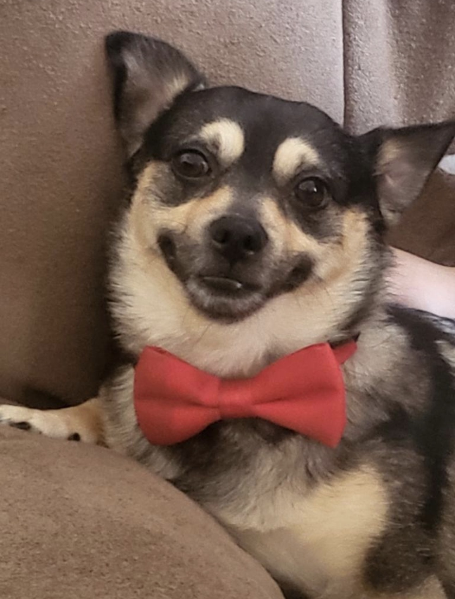
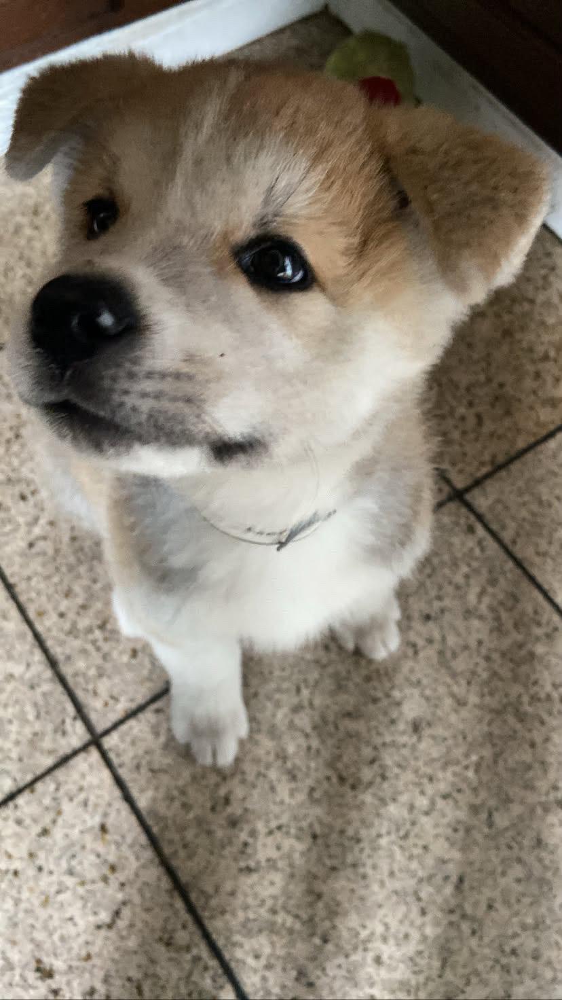
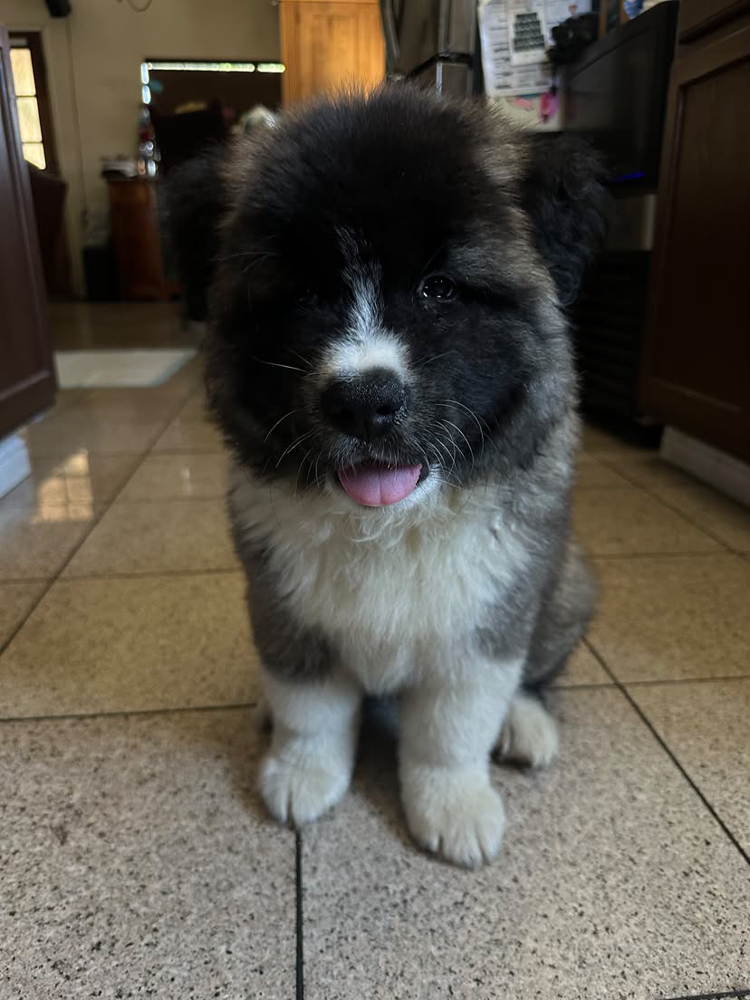
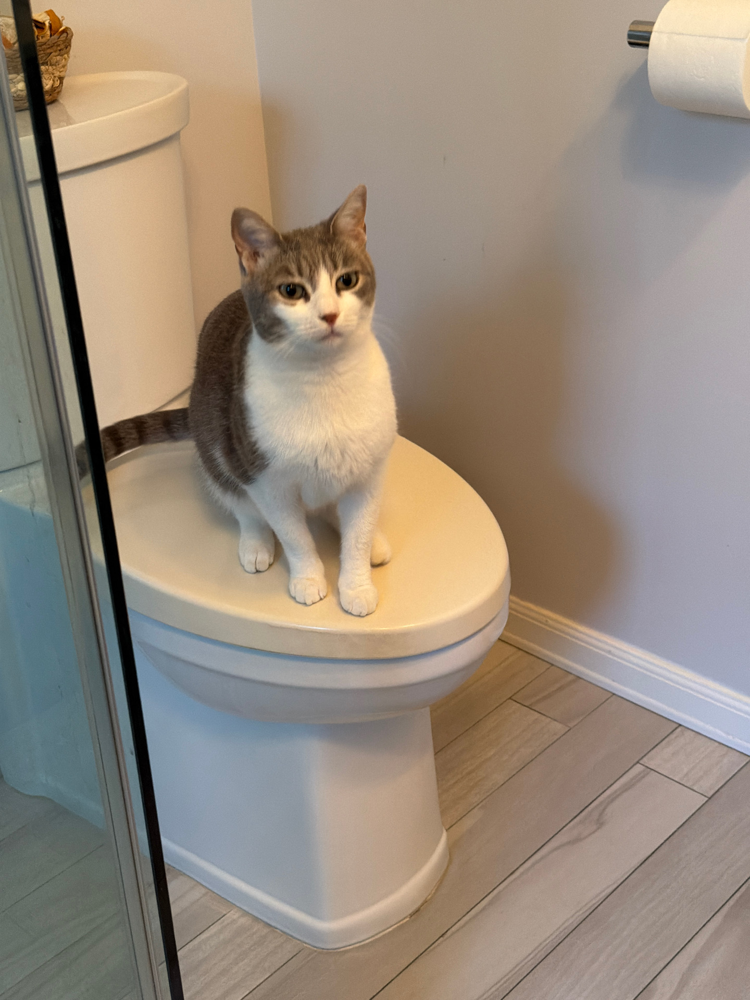

<!DOCTYPE html>
<html>
  

Bear is a black and brown eight-year-old dog. His owners got him when he was only a few months old as a Christmas gift to their daughter. He is a very spoiled dog. He loves eating food, especially treats. However, he doesn't play with any toys and only enjoys running around or playful biting. He can be very lazy sometimes, as he also loves to sleep and lounge around. He is an absolute sweetheart and loves meeting new people, but he does get annoyed if you mess with him for too long.

  
  
  
</html>
